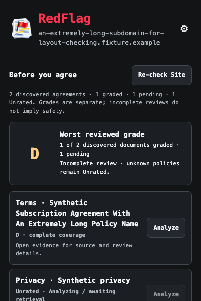
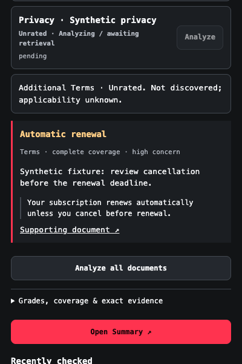

# Popup redesign verification — 2026-10-11

Branch `codex/popup-redesign`, separate managed worktree, based on local main `d306957`. Implementation commit `6c08929`; subsequent integration/verification commit recorded in the handoff. No merge to main.

## Implemented presentation

400px charcoal popup, 600px viewport with vertical scrolling, supplied logo unchanged, wrapping domain/name text, settings shortcut, real one/all/recheck actions, explicit worst-reviewed-document grade and reviewed/discovered counts, independent document rows, missing kinds/applicability unknown, sourced warnings with exact quotation and source links, detailed evidence/coverage/freshness/provider disclosure, Open Summary, and real Recently checked entries. Pending, partial, rated, Unrated, permission-required, inaccessible, AI-disabled, discovering/no-review and restricted-browser-page states are rendered without fictional fallback results. A grade does not assert every agreement on a site was discovered.

Consent/site permissions, local-only source preview and explicitly fictional demo remain available in collapsible sections. Settings mutations use the dashboard's Web Lock and reload current settings before applying changed fields, avoiding stale consent overwrites. No font, key or unrelated page text is transmitted by presentation code.

## Checks

- `npm run check`: strict TypeScript, 29 tests, extension build.
- `npm run test:browser`: actual unpacked extension, demo separation, priorities/persistence, affirmative consent/revocation and failed saves, restricted page, stale/wrong-page messages.
- `npm run test:ui`: proactive component regression with fixtures, independent grades/coverage, dates, quotations, safe text rendering, focus/dismissal.
- `npm run test:discovery-browser`: actual unpacked worker/content regression; retrieval and AI responses simulated.
- `npm run test:popup-redesign`: actual unpacked extension popup document in Chromium at 400 × 600. Synthetic states cover discovering, analyzing, partial, rated, Unrated, permission-required, inaccessible, AI-disabled and restricted pages; long domain/policy wrapping, no horizontal overflow, keyboard settings access, popup reload/consent, logo decode and temporary monospace/no font requests. Checks shared text/action/focus colors exceed 4.5:1 against their backgrounds (disabled controls excluded).
- `npm run test:actions-browser`: actual worker queue plus real popup button clicks for one/all/recheck, cache/dedup/concurrency, mixed failures, timeout, close/reopen, stale generations, per-tab badges, real history item, Open Summary and recent-item dashboard routes. Public document and Gemini responses simulated; no live grade asserted.
- `npm run test:dashboard`: actual unpacked dashboard integration, independent records, keyboard, popup bidirectional consent/preferences, failure handling, restart/delete/clear. Provider records are fixtures.

Screenshots below are **synthetic fixtures in the actual unpacked extension**, not live website/Gemini results. The restricted-page screenshot is an actual unsupported extension/browser page state. Visually inspected the partial and evidence views. Headless Chromium verifies the popup document/scrolling, not the native toolbar popup shell on every supported browser or OS.

Other captures in `screenshots/`: discovering, analyzing, rated, unrated, permission-required, inaccessible, AI-disabled, restricted-browser-page.

## Integration

Owned files: `src/extension/popup.{html,css,ts}`, `src/ui/popup-review.ts`, shared `src/ui/{theme,styles}.ts`, failure-message presentation in `src/ui/review.ts`, popup/browser test updates and this design record. Existing worker code was integrated via their commits; no background analysis/server/history implementation was authored here. Shared contract/API `c96d1fe`, actions `c0ad2e6`, history `e057165`/`02fcffc`, dashboard/build `14d6eef` are dependencies. Keep worker followups when integrating; do not duplicate the earlier backend setup or copy private `.env` files.

Popup sends trusted `requestAnalysis({type:'redflag/analyze',mode:'one'|'all'|'recheck',pageKey,documentId?})`. Acknowledgment means queued/admitted, not successful grading; subsequent matching `redflag/state` updates paint results. Recently checked uses `listHistory`/`subscribeHistory` and `mountRecentItems`; routes are `dashboard.html#site=<encoded origin>`. No general browsing history is added by popup.

Reproduce: `npm ci`, run checks above, load `dist/extension` unpacked. AI consent is off by default. Actual analysis requires Agent 2's running authenticated backend, trusted backend configuration and granted public-document/server origins. Keys remain only in the server's ignored environment configuration. Tests need no credentials.

## Remaining limitations

Monoglyphic typography is unfinished. See [authorization record](typography.md); no purchase, authorized font file or distribution permission obtained. The explicitly temporary system monospace fallback is not Monoglyphic. Live backend/provider grading is owned and separately verified by the analysis worker; these popup tests use simulated results. Coverage can remain partial/Unrated under existing extraction behavior. Native toolbar sizing and glyph differences across OS/browser versions still need manual release validation.
